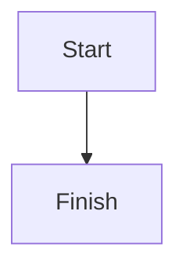

# MD to PDF

A Node.js ESM CLI that converts Markdown into PDF using [Puppeteer](https://pptr.dev/), with support for:

- Mermaid diagrams rendered in Chromium
- KaTeX-rendered LaTeX math
- optional custom CSS injection
- print-safe Mermaid scaling
- five bundled print themes (default, OLED, warm paper, high contrast, compact)

The main entrypoint is [`convert.js`](convert.js), which reads Markdown, builds HTML, renders Mermaid and KaTeX in the browser, and exports the final PDF.

## Features

- Markdown to PDF conversion via [`renderPdf()`](src/core/render-pdf.js:74)
- Optional stylesheet injection via [`--style`](src/core/document-options.js)
- Document title via [`--title`](src/core/document-options.js), applied to the HTML `<title>`
- Mermaid fenced code block support in [`renderMarkdown()`](src/core/render-markdown.js:204)
- Inline LaTeX support with [`$...$`](src/core/render-markdown.js:6)
- Block LaTeX support with [`$$...$$`](src/core/render-markdown.js:7)
- Dynamic Mermaid scaling using [`.mermaid`](src/core/build-html.js:41) and [`.mermaid svg`](src/core/build-html.js:51)
- Readiness flag names shared between the injected browser program and the renderer by [`readiness-protocol.js`](src/core/readiness-protocol.js:32)
- Wait logic for both Mermaid and KaTeX completion flags in [`waitForFlag()`](src/core/render-pdf.js:46)
- Bundled themes in [`styles/`](styles/): default light, OLED dark, warm paper, high contrast, and compact

## Requirements

- Node.js 18+
- macOS, Linux, or Windows with Chromium support through Puppeteer

The engine requirement is defined in [`package.json`](package.json:31).

## Installation

Install dependencies:

```bash
npm install
```

Dependencies are declared in [`package.json`](package.json), including:
- [`marked`](package.json:27)
- [`puppeteer`](package.json:28)

The browser loads KaTeX and Mermaid from a CDN at render time; the versions the
document targets are owned by `src/core/katex-bootstrap.js` and
`src/core/mermaid-bootstrap.js`, so nothing is fetched from npm to render.

## Usage

Basic command:

```bash
node convert.js input.md output.pdf
```

With a stylesheet:

```bash
node convert.js input.md output.pdf --style ./styles/style.css
```

With a document title (sets the HTML `<title>` and the PDF metadata title):

```bash
node convert.js input.md output.pdf --title 'Quarterly Report'
```

Any theme in [`styles/`](styles/) is selected the same way:

```bash
node convert.js input.md output.pdf --style ./styles/oled-style.css
node convert.js input.md output.pdf --style ./styles/paper-style.css
node convert.js input.md output.pdf --style ./styles/contrast-style.css
node convert.js input.md output.pdf --style ./styles/compact-style.css
```

Argument parsing is handled by [`parseArgs()`](src/cli/parse-args.js), which fills the
document options defined in [`document-options.js`](src/core/document-options.js).

The accepted flags — two optional ones, after the input and output paths:

| Flag | Meaning |
|---|---|
| `--style <path>` | Optional stylesheet, loaded and injected into the document. |
| `--title <string>` | Document title, used for the HTML `<title>` and the PDF metadata. |

Unknown flags are rejected with an error naming the flag. `--format` (page size) and
`--margin` (page margin) are **not implemented** and are rejected with an error saying
so — passing them will not produce a differently shaped PDF. Until they are built, page
size is fixed at A4 and page margins are owned by [`page-geometry.js`](src/core/page-geometry.js),
which emits the document's single `@page` rule; a theme supplies its margin as a CSS
variable rather than declaring a rule.
Both lists live in [`document-options.js`](src/core/document-options.js:62), so the
documented set and the implemented set cannot drift apart.

## Supported Markdown Enhancements

### Mermaid

Use fenced Mermaid blocks:

````md

````

Mermaid fences are converted into [`.mermaid`](src/core/render-markdown.js:58) containers by [`renderMarkdown()`](src/core/render-markdown.js:204).

### LaTeX

Inline math:

```md
Einstein wrote $E = mc^2$.
```

Block math:

```md
$$
\int_{-\infty}^{\infty} e^{-x^2} dx = \sqrt{\pi}
$$
```

Math is tokenised by the `blockMath` and `inlineMath` extensions in
[`render-markdown.js`](src/core/render-markdown.js:101), which wrap expressions in
`.math-display` and `.math-inline` elements. KaTeX renders them client-side in the
bootstrap inside [`build-html.js`](src/core/build-html.js:203).

### Protected regions

The math extensions are `marked` tokenizers, not a regex pre-pass, so they are never
given text that belongs to some other construct. Math is therefore left alone inside:

- fenced code blocks
- Mermaid code fences
- inline code spans
- indented code blocks, blockquotes, and list containers

That protection comes from the tokenizer boundaries in
[`render-markdown.js`](src/core/render-markdown.js), not from a regex pre-pass over the
raw document. (The separate escaping step inside the wrappers exists to keep LaTeX valid
as HTML text — a `<` in `a<c^k` would otherwise open a tag — and is unrelated to region
protection.)

## Rendering Pipeline

The CLI flow is:

1. Parse arguments into document options in [`parseArgs()`](src/cli/parse-args.js) and [`createDocumentOptions()`](src/core/document-options.js:77)
2. Read Markdown and optional CSS in [`readMarkdown()`](src/core/load-input.js:13) and [`readStylesheet()`](src/core/load-input.js:29)
3. Convert Markdown to HTML in [`renderMarkdown()`](src/core/render-markdown.js:204)
4. Build the full HTML document in [`buildHtml()`](src/core/build-html.js:268), which consumes the options whole
5. Render Mermaid and KaTeX in Chromium and export PDF in [`renderPdf()`](src/core/render-pdf.js:74)
6. Write the file in [`writePdfOutput()`](src/core/write-output.js:22), classifying failures as input errors

## CSS Injection

Any file passed with [`--style`](src/core/document-options.js) is read and injected into the generated HTML document by [`buildHtml()`](src/core/build-html.js).

This allows you to reuse existing typography, spacing, colors, and print rules.

## Mermaid Scaling Strategy

Mermaid rendering is configured by [`mermaidInitOptions()`](src/core/mermaid-bootstrap.js) using:

- `theme: 'base'`
- `startOnLoad: false`
- print-safe rendering behavior

Scaling and containment are handled by:
- [`.mermaid`](src/core/build-html.js:41)
- [`.mermaid svg`](src/core/build-html.js:51)

Current behavior:
- diagrams are centered
- wide diagrams shrink to fit width
- tall diagrams respect a `45vh` ceiling
- small diagrams are not unnecessarily upscaled
- page-break issues are reduced with `break-inside: avoid`

## KaTeX Rendering Strategy

KaTeX support is injected by:
- [`KATEX_CSS`](src/core/build-html.js:65)
- [`KATEX_BOOTSTRAP`](src/core/build-html.js:203)

The browser waits for both:
- `window.__MERMAID_RENDER_DONE__` and `window.__MATH_RENDER_DONE__`, whose spellings are
  owned by [`READINESS_FLAGS`](src/core/readiness-protocol.js:32) and inlined into the
  injected programs by [`readinessFlagsSource()`](src/core/readiness-protocol.js:58).

The wait logic lives in [`waitForFlag()`](src/core/render-pdf.js:46). The KaTeX bootstrap
awaits Mermaid readiness before touching the DOM, because the two CDN bootstraps used to
race and break diagrams late in a large document.

## Stylesheets

### Bundled themes

| Theme | File | Character |
|---|---|---|
| Default | [`styles/style.css`](styles/style.css) | Academic light. Serif body, indigo headings. |
| OLED | [`styles/oled-style.css`](styles/oled-style.css) | True-black surface and neon accents, for dark viewing. |
| Warm paper | [`styles/paper-style.css`](styles/paper-style.css) | Sepia reading surface, rust accent, generous leading for long-form study. |
| High contrast | [`styles/contrast-style.css`](styles/contrast-style.css) | Black on white (21:1) meeting WCAG AAA, hierarchy carried by weight and rules rather than hue. |
| Compact | [`styles/compact-style.css`](styles/compact-style.css) | Dense revision layout: smaller type, tighter margins, sections run on instead of breaking. |

### Mermaid label colour

Mermaid compiles `style X fill:…,color:…` directives in Markdown into **inline `!important`**
declarations, which outrank any stylesheet rule, including `!important` ones. Left alone this
makes some diagram labels keep their author colour while others take the theme colour.

A theme opts in to correcting this by defining `--mermaid-normalize`. The Mermaid browser
program in [`mermaid-bootstrap.js`](src/core/mermaid-bootstrap.js) — inlined into the document at
assembly time — then strips the inline text colours after render so the
theme governs every label evenly. The OLED, warm paper, high contrast, and compact themes opt in;
the default theme leaves author colours untouched. Author **fill** colours are always preserved.

### Known limitation

Mermaid v11 draws node shapes as `<path>` elements, so the themes outline nodes rather than
recolour them. Theme node-fill rules that target `rect`/`circle` only are inert.

## Test Fixtures

[`documents/`](documents/) holds two fixture documents. They are checked in and are used
by the test suite as rendering inputs:

- [`documents/test-math.md`](documents/test-math.md) — KaTeX and Mermaid mixed validation.
  This is the large-mixed-document fixture: math and diagrams in the same document, which
  is the combination that historically broke.
- [`documents/test-fixtures.md`](documents/test-fixtures.md) — Mermaid edge-case validation
  (wide, tall, small, and long-label diagrams).

The fixture tests in [`test/fixtures.test.js`](test/fixtures.test.js) read both documents
and drive them through Markdown rendering and HTML assembly, asserting the resulting
structure. They do not launch a browser, so the suite needs no Chromium.

No generated PDF is committed: `.gitignore` excludes `*.pdf`. The fixtures are Markdown
sources only; rendered output is written wherever you point it (see
[Manual render check](#manual-render-check)).

## Testing

Unit tests use Node's built-in test runner — no extra dependencies:

```bash
npm test
```

Test files live in [`test/`](test/) and cover argument parsing, document options,
Markdown/Mermaid/math rendering, HTML assembly, the readiness protocol, fixture-document
regressions, input loading, output writing, and error handling. No test launches a
browser, so `npm test` does not require Chromium.

Rendering changes still need a manual PDF check — see [Manual render check](#manual-render-check).

## Example Commands

Standard theme:

```bash
node convert.js documents/test-fixtures.md /tmp/test-fixtures.pdf --style ./styles/style.css
```

Math + standard theme:

```bash
node convert.js documents/test-math.md /tmp/test-math.pdf --style ./styles/style.css
```

Math + OLED theme:

```bash
node convert.js documents/test-math.md /tmp/test-math-oled.pdf --style ./styles/oled-style.css
```

These write to `/tmp` because `*.pdf` is gitignored: generated output belongs outside the
working tree, not in `documents/`.

## File Overview

Entrypoint and CLI:

- [`convert.js`](convert.js) — CLI entrypoint; wires the six pipeline steps together
- [`src/cli/parse-args.js`](src/cli/parse-args.js) — argument parsing; an adapter over the document options module

Core pipeline, in call order:

- [`src/core/document-options.js`](src/core/document-options.js) — the complete document option set, its defaults, the flag table, and the rejected-option table
- [`src/core/load-input.js`](src/core/load-input.js) — Markdown and stylesheet file loading
- [`src/core/render-markdown.js`](src/core/render-markdown.js) — Markdown rendering; the Mermaid, block-math, and inline-math tokenizers live here
- [`src/core/readiness-protocol.js`](src/core/readiness-protocol.js) — the readiness flag names, as one source of truth for both the injected browser program and the renderer
- [`src/core/mermaid-bootstrap.js`](src/core/mermaid-bootstrap.js) — the Mermaid browser program: the render loop, the label-normalisation luminance rule, and render diagnostics; inlined into the document at assembly time
- [`src/core/build-html.js`](src/core/build-html.js) — HTML assembly: base and print stylesheets, inlining the Mermaid program, the KaTeX bootstrap, and the protocol inlining
- [`src/core/render-pdf.js`](src/core/render-pdf.js) — Puppeteer launch, readiness polling, error classification, and PDF export
- [`src/core/write-output.js`](src/core/write-output.js) — writes the PDF, reporting filesystem failures as input errors
- [`src/core/errors.js`](src/core/errors.js) — CLI-friendly errors carrying exit codes

Stylesheets and assets:

- [`styles/style.css`](styles/style.css) — default light stylesheet
- [`styles/oled-style.css`](styles/oled-style.css) — OLED dark stylesheet
- [`styles/paper-style.css`](styles/paper-style.css) — warm paper stylesheet
- [`styles/contrast-style.css`](styles/contrast-style.css) — high-contrast stylesheet
- [`styles/compact-style.css`](styles/compact-style.css) — compact stylesheet
- [`documents/`](documents/) — the two fixture Markdown documents; no generated PDFs are tracked
- [`test/`](test/) — the test suite
- [`GLOSSARY.md`](GLOSSARY.md) — the project's domain and architecture vocabulary

## Manual render check

Every change that affects rendering needs a real PDF render, not just a passing suite.
Render a fixture and look at the output:

```bash
node convert.js documents/test-math.md /tmp/test-math.pdf --style ./styles/style.css
node convert.js documents/test-math.md /tmp/test-math-oled.pdf --style ./styles/oled-style.css
node convert.js documents/test-fixtures.md /tmp/test-fixtures.pdf --style ./styles/style.css
```

A normal render exits 0 and produces a file of roughly 80–100 KB. Confirm that the
math typesets, the diagrams render with legible labels, and no raw LaTeX or diagram
source appears as visible text.

## Notes

- The CLI supports [`--style`](src/core/document-options.js) and [`--title`](src/core/document-options.js); both are declared in the document options module.
- Unknown flags are rejected with an error naming the flag in [`parseArgs()`](src/cli/parse-args.js).
- `--format` and `--margin` are not implemented; passing either is an error, not a silent no-op. Page size is fixed at A4 and page geometry (margins, sheet background, page number, cover page) is owned by [`pageGeometry()`](src/core/page-geometry.js), which emits the document's one `@page` rule and the renderer's `preferCSSPageSize`; themes supply geometry as CSS variables.
- The readiness flag names live in [`READINESS_FLAGS`](src/core/readiness-protocol.js:32); the injected bootstraps and the renderer both reference them through it.
- Output-file write failures are reported as input errors (exit code 2) by [`writePdfOutput()`](src/core/write-output.js).
- Mermaid debug output is printed when `MD_TO_PDF_DEBUG` is set, in [`renderPdf()`](src/core/render-pdf.js).
