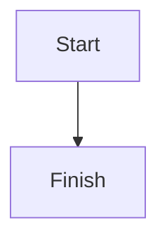

# MD to PDF

A Node.js ESM CLI that converts Markdown into PDF using [Puppeteer](https://pptr.dev/), with support for:

- Mermaid diagrams rendered in Chromium
- KaTeX-rendered LaTeX math
- optional custom CSS injection
- print-safe Mermaid scaling
- five bundled print themes (default, OLED, warm paper, high contrast, compact)

The main entrypoint is [`convert.js`](convert.js), which reads Markdown, builds HTML, renders Mermaid and KaTeX in the browser, and exports the final PDF.

This README cites files and symbols rather than line numbers. A line anchor is wrong the
moment anyone edits the file above it; a symbol name is checked by the test suite.

## Features

- Markdown to PDF conversion via [`renderPdf()`](src/core/render-pdf.js)
- Optional stylesheet injection via [`--style`](src/core/document-options.js)
- Document title via [`--title`](src/core/document-options.js), applied to the HTML `<title>`
- Mermaid fenced code block support in [`renderMarkdown()`](src/core/render-markdown.js)
- Inline LaTeX support with `$...$`, tokenised by `inlineMathExtension` in [`render-markdown.js`](src/core/render-markdown.js)
- Block LaTeX support with `$$...$$`, tokenised by `blockMathExtension` in [`render-markdown.js`](src/core/render-markdown.js)
- Dynamic Mermaid scaling in [`mermaid-containment.css`](src/core/print-styles/mermaid-containment.css), which owns the `.mermaid` container and `.mermaid svg` sizing rules
- Readiness flag names shared between the injected browser program and the renderer by [`READINESS_FLAGS`](src/core/readiness-protocol.js)
- Wait logic for both Mermaid and KaTeX completion flags in [`waitForReadiness()`](src/core/readiness-protocol.js)
- Bundled themes in [`styles/`](styles/): default light, OLED dark, warm paper, high contrast, and compact

## Requirements

- Node.js 18+
- macOS, Linux, or Windows with Chromium support through Puppeteer

The engine requirement is the `engines` field in [`package.json`](package.json).

## Installation

Install dependencies:

```bash
npm install
```

Dependencies are declared in [`package.json`](package.json), and are exactly two:
- `marked` — Markdown parsing
- `puppeteer` — the browser that renders the page

The browser loads KaTeX and Mermaid from a CDN at render time. The KaTeX version the
document targets is owned by `KATEX_VERSION` in [`katex-bootstrap.js`](src/core/katex-bootstrap.js)
and the Mermaid URL by `MERMAID_CDN_URL` in [`mermaid-bootstrap.js`](src/core/mermaid-bootstrap.js),
so nothing is fetched from npm to render. There is no `katex` dependency: the lockfile had
once resolved a release the CDN never served, and the constant in the module is now the
only place the version is written.

## Usage

Basic command:

```bash
node convert.js input.md output.pdf
```

With a stylesheet:

```bash
node convert.js input.md output.pdf --style ./styles/style.css
```

With a document title (sets the HTML `<title>` and the PDF metadata title):

```bash
node convert.js input.md output.pdf --title 'Quarterly Report'
```

Any theme in [`styles/`](styles/) is selected the same way:

```bash
node convert.js input.md output.pdf --style ./styles/oled-style.css
node convert.js input.md output.pdf --style ./styles/paper-style.css
node convert.js input.md output.pdf --style ./styles/contrast-style.css
node convert.js input.md output.pdf --style ./styles/compact-style.css
```

Argument parsing is handled by [`parseArgs()`](src/cli/parse-args.js), which fills the
document options defined in [`document-options.js`](src/core/document-options.js).

The accepted flags — two optional ones, after the input and output paths:

| Flag | Meaning |
|---|---|
| `--style <path>` | Optional stylesheet, loaded and injected into the document. |
| `--title <string>` | Document title, used for the HTML `<title>` and the PDF metadata. |

Unknown flags are rejected with an error naming the flag. `--format` (page size) and
`--margin` (page margin) are **not implemented** and are rejected with an error saying
so — passing them will not produce a differently shaped PDF. Until they are built, page
size is fixed at A4 and page margins are owned by [`pageGeometry()`](src/core/page-geometry.js),
which emits the document's single `@page` rule; a theme supplies its margin as a CSS
variable rather than declaring a rule.

Both lists live in [`document-options.js`](src/core/document-options.js) — `DOCUMENT_OPTION_FLAGS`
for what is accepted and `UNIMPLEMENTED_OPTIONS` for what is rejected-but-documented — so
the documented set and the implemented set cannot drift apart.

## Supported Markdown Enhancements

### Mermaid

Use fenced Mermaid blocks:

````md

````

Mermaid fences are converted into `.mermaid` containers by `mermaidExtension` in
[`render-markdown.js`](src/core/render-markdown.js), which [`renderMarkdown()`](src/core/render-markdown.js)
applies.

### LaTeX

Inline math:

```md
Einstein wrote $E = mc^2$.
```

Block math:

```md
$$
\int_{-\infty}^{\infty} e^{-x^2} dx = \sqrt{\pi}
$$
```

Math is tokenised by the `blockMathExtension` and `inlineMathExtension` extensions in
[`render-markdown.js`](src/core/render-markdown.js), which wrap expressions in
`.math-display` and `.math-inline` elements. KaTeX renders them client-side in the
bootstrap inside [`katex-bootstrap.js`](src/core/katex-bootstrap.js), whose source
assembly inlines into the document.

### Protected regions

The math extensions are `marked` tokenizers, not a regex pre-pass, so they are never
given text that belongs to some other construct. Math is therefore left alone inside:

- fenced code blocks
- Mermaid code fences
- inline code spans
- indented code blocks, blockquotes, and list containers

That protection comes from the tokenizer boundaries in
[`render-markdown.js`](src/core/render-markdown.js), not from a regex pre-pass over the
raw document. (The separate escaping step inside the wrappers exists to keep LaTeX valid
as HTML text — a `<` in `a<c^k` would otherwise open a tag — and is unrelated to region
protection.)

## Rendering Pipeline

The CLI flow is:

1. Parse arguments into document options in [`parseArgs()`](src/cli/parse-args.js) and [`createDocumentOptions()`](src/core/document-options.js)
2. Read Markdown and optional CSS in [`readMarkdown()`](src/core/load-input.js) and [`readStylesheet()`](src/core/load-input.js)
3. Convert Markdown to HTML in [`renderMarkdown()`](src/core/render-markdown.js)
4. Build the full HTML document in [`buildHtml()`](src/core/build-html.js), which reads the option values it emits from the options object
5. Render Mermaid and KaTeX in Chromium and export PDF in [`renderPdf()`](src/core/render-pdf.js)
6. Write the file in [`writePdfOutput()`](src/core/write-output.js), classifying failures as input errors

The call site passes the options object whole, so adding an option needs no change in
[`convert.js`](convert.js). Assembly is a different matter: it has to read and emit the
values it cares about, so an option that reaches the document needs a line in
[`buildHtml()`](src/core/build-html.js). The title is the current example.

## CSS Injection

Any file passed with [`--style`](src/core/document-options.js) is read and injected into the generated HTML document by [`buildHtml()`](src/core/build-html.js).

This allows you to reuse existing typography, spacing, colors, and print rules.

## Mermaid Scaling Strategy

Mermaid rendering is configured by [`mermaidInitOptions()`](src/core/mermaid-bootstrap.js) using:

- `theme: 'base'`
- `startOnLoad: false`
- print-safe rendering behavior

Scaling and containment are handled by [`mermaid-containment.css`](src/core/print-styles/mermaid-containment.css),
which owns the `.mermaid` container rules and the `.mermaid svg` sizing declarations.
Mermaid label colour, type and shape paint are handled by the shared block in
[`mermaid-styles/mermaid.css`](src/core/mermaid-styles/mermaid.css).

Current behavior:
- diagrams are centered
- wide diagrams shrink to fit width
- tall diagrams respect a `45vh` ceiling
- small diagrams are not unnecessarily upscaled
- page-break issues are reduced with `break-inside: avoid`

## KaTeX Rendering Strategy

KaTeX support is injected in two parts:
- [`KATEX_STYLESHEET_URL`](src/core/katex-bootstrap.js) — a `<link rel="stylesheet">` in the
  document head, carrying the glyph stylesheet KaTeX's fonts are referenced from. It is
  emitted for every document.
- `runKatexBootstrap()` in [`katex-bootstrap.js`](src/core/katex-bootstrap.js) — the browser
  program, whose source assembly inlines and whose entry point it calls. The runtime itself
  is imported from [`KATEX_SCRIPT_URL`](src/core/katex-bootstrap.js) only when the document
  contains math.

The document therefore makes up to three runtime fetches: two CDN imports inside the
bootstraps (each guarded by a node-count check, so a document with no diagrams and no
expressions fetches neither) and the KaTeX stylesheet link, which is unconditional.

The browser waits for both:
- `window.__MERMAID_RENDER_DONE__` and `window.__MATH_RENDER_DONE__`, whose spellings are
  owned by [`READINESS_FLAGS`](src/core/readiness-protocol.js) and inlined into the
  injected programs by [`readinessFlagsSource()`](src/core/readiness-protocol.js).

The wait logic lives in [`waitForReadiness()`](src/core/readiness-protocol.js), which takes
one flag name and a page evaluator — it has no browser of its own. The KaTeX bootstrap
awaits Mermaid readiness before touching the DOM, because the two CDN bootstraps used to
race and break diagrams late in a large document.

## Stylesheets

### Bundled themes

| Theme | File | Character |
|---|---|---|
| Default | [`styles/style.css`](styles/style.css) | Academic light. Serif body, indigo headings. |
| OLED | [`styles/oled-style.css`](styles/oled-style.css) | True-black surface and neon accents, for dark viewing. |
| Warm paper | [`styles/paper-style.css`](styles/paper-style.css) | Sepia reading surface, rust accent, generous leading for long-form study. |
| High contrast | [`styles/contrast-style.css`](styles/contrast-style.css) | Black on white (21:1) meeting WCAG AAA, hierarchy carried by weight and rules rather than hue. |
| Compact | [`styles/compact-style.css`](styles/compact-style.css) | Dense revision layout: smaller type, tighter margins, sections run on instead of breaking. |

A theme supplies a palette and page geometry values. It declares no `@page` rule and no
Mermaid selector list: the page rule belongs to [`page-geometry.js`](src/core/page-geometry.js)
and the selectors to [`mermaid-styles/mermaid.css`](src/core/mermaid-styles/mermaid.css).

### Mermaid label colour

Mermaid compiles `style X fill:…,color:…` directives in Markdown into **inline `!important`**
declarations, which outrank any stylesheet rule, including `!important` ones. Left alone this
makes some diagram labels keep their author colour while others take the theme colour.

A theme opts in to correcting this by defining `--mermaid-normalize`. The Mermaid browser
program in [`mermaid-bootstrap.js`](src/core/mermaid-bootstrap.js) — inlined into the document at
assembly time — then strips the inline text colours after render so the
theme governs every label evenly. The OLED, warm paper, high contrast, and compact themes opt in;
the default theme leaves author colours untouched. Author **fill** colours are always preserved.

### Page geometry

Page margins, sheet background and the printed page number are one owned value. A theme
sets CSS variables — `--page-margin`, `--page-background`, `--page-footer-font-size`,
`--page-footer-color`, and their siblings, named by `PAGE_GEOMETRY_VARIABLES` in
[`page-geometry.js`](src/core/page-geometry.js) — and the module writes the single `@page`
rule that reads them, with the geometry defaults as fallbacks.

The named cover page is opt-in: pass a `cover` margin in the geometry and the module emits
`@page cover` alongside the page rule. No bundled theme styles a cover element, because no
bundled document produces one.

Every bundled theme must also satisfy a small set of cross-variable rules, declared as data in
`PAGE_GEOMETRY_INVARIANTS` and checked by `violatedInvariants()`: every theme must declare
`--page-margin`, and a theme that sets `--page-background` must also set `--page-footer-color`, so
a dark or tinted sheet never ships with the footer ink chosen for white paper. The typographic
footer overrides stay optional, so `DEFAULT_PAGE_GEOMETRY` remains the only owner of the defaults.
Adding a rule is one entry in that list; the test suite applies it to every stylesheet in `styles/`
as soon as it exists.

### Known limitation

Mermaid v11 draws node shapes as `<path>` elements, so the themes outline nodes rather than
recolour them. Theme node-fill rules that target `rect`/`circle` only are inert.

## Test Fixtures

[`documents/`](documents/) holds two fixture documents. They are checked in and are used
by the test suite as rendering inputs:

- [`documents/test-math.md`](documents/test-math.md) — KaTeX and Mermaid mixed validation.
  This is the large-mixed-document fixture: math and diagrams in the same document, which
  is the combination that historically broke.
- [`documents/test-fixtures.md`](documents/test-fixtures.md) — Mermaid edge-case validation
  (wide, tall, small, and long-label diagrams).

The fixture tests in [`test/fixtures.test.js`](test/fixtures.test.js) read both documents
and drive them through Markdown rendering and HTML assembly, asserting the resulting
structure. They do not launch a browser, so the suite needs no Chromium.

No generated PDF is committed: `.gitignore` excludes `*.pdf`. The fixtures are Markdown
sources only; rendered output is written wherever you point it (see
[Manual render check](#manual-render-check)).

## Testing

Unit tests use Node's built-in test runner — no extra dependencies:

```bash
npm test
```

Test files live in [`test/`](test/) and cover argument parsing, document options,
Markdown/Mermaid/math rendering, HTML assembly, the readiness protocol, page geometry,
the print stylesheets, fixture-document regressions, input loading, output writing, and
error handling. One test also guards this README: it fails if a reference grows a line
anchor or a link stops resolving, so the documentation cannot quietly rot. No test
launches a browser, so `npm test` does not require Chromium.

The theme-contract tests discover themes by reading `styles/`, so a sixth stylesheet is
covered by the half-styled-theme and page-geometry guards the moment its file lands.

Rendering changes still need a manual PDF check — see [Manual render check](#manual-render-check).

## Example Commands

Standard theme:

```bash
node convert.js documents/test-fixtures.md /tmp/test-fixtures.pdf --style ./styles/style.css
```

Math + standard theme:

```bash
node convert.js documents/test-math.md /tmp/test-math.pdf --style ./styles/style.css
```

Math + OLED theme:

```bash
node convert.js documents/test-math.md /tmp/test-math-oled.pdf --style ./styles/oled-style.css
```

These write to `/tmp` because `*.pdf` is gitignored: generated output belongs outside the
working tree, not in `documents/`.

## File Overview

Entrypoint and CLI:

- [`convert.js`](convert.js) — CLI entrypoint; wires the pipeline steps together
- [`src/cli/parse-args.js`](src/cli/parse-args.js) — argument parsing; an adapter over the document options module

Core pipeline, in call order:

- [`src/core/document-options.js`](src/core/document-options.js) — the complete document option set, its defaults, the flag table, and the rejected-option table
- [`src/core/load-input.js`](src/core/load-input.js) — Markdown and stylesheet file loading
- [`src/core/render-markdown.js`](src/core/render-markdown.js) — Markdown rendering; the Mermaid, block-math, and inline-math tokenizers live here
- [`src/core/readiness-protocol.js`](src/core/readiness-protocol.js) — the readiness flag names, the waiting step, and the error-report classification; one source of truth for both the injected browser programs and the renderer
- [`src/core/mermaid-bootstrap.js`](src/core/mermaid-bootstrap.js) — the Mermaid browser program: the render loop, the label-normalisation luminance rule, and render diagnostics; inlined into the document at assembly time
- [`src/core/katex-bootstrap.js`](src/core/katex-bootstrap.js) — the KaTeX browser program and the only place its CDN version is written; inlined into the document at assembly time
- [`src/core/css-declarations.js`](src/core/css-declarations.js) — reads custom-property declarations out of CSS text: which names a stylesheet declares, which it leaves hollow, and what it declares once comments are removed; shared by page geometry and Mermaid styling
- [`src/core/page-geometry.js`](src/core/page-geometry.js) — page geometry: the `@page` rule, the optional named cover page, the theme variable names, the theme invariants those variables must satisfy, and the browser's print preference
- [`src/core/build-html.js`](src/core/build-html.js) — HTML assembly: emitting the stylesheet layers in order, inlining both browser programs, and inlining the protocol
- [`src/core/render-pdf.js`](src/core/render-pdf.js) — Puppeteer launch, readiness polling, error classification, and PDF export
- [`src/core/write-output.js`](src/core/write-output.js) — writes the PDF, reporting filesystem failures as input errors
- [`src/core/errors.js`](src/core/errors.js) — CLI-friendly errors carrying exit codes

Stylesheets and assets:

- [`styles/style.css`](styles/style.css) — default light stylesheet
- [`styles/oled-style.css`](styles/oled-style.css) — OLED dark stylesheet
- [`styles/paper-style.css`](styles/paper-style.css) — warm paper stylesheet
- [`styles/contrast-style.css`](styles/contrast-style.css) — high-contrast stylesheet
- [`styles/compact-style.css`](styles/compact-style.css) — compact stylesheet
- [`src/core/print-styles/`](src/core/print-styles/) — the print stylesheets every document needs, independent of theme: `base.css`, `mermaid-containment.css`, and `math.css`, plus [`print-styles.js`](src/core/print-styles/print-styles.js), the module that names them and returns the layers assembly emits
- [`src/core/mermaid-styles/`](src/core/mermaid-styles/) — the shared Mermaid styling block (`mermaid.css`) and [`mermaid-styles.js`](src/core/mermaid-styles/mermaid-styles.js), the module that reads it and states the theme variable contract
- [`documents/`](documents/) — the two fixture Markdown documents; no generated PDFs are tracked
- [`test/`](test/) — the test suite
- [`GLOSSARY.md`](GLOSSARY.md) — the project's domain and architecture vocabulary

## Manual render check

Every change that affects rendering needs a real PDF render, not just a passing suite.
Render a fixture and look at the output:

```bash
node convert.js documents/test-math.md /tmp/test-math.pdf --style ./styles/style.css
node convert.js documents/test-math.md /tmp/test-math-oled.pdf --style ./styles/oled-style.css
node convert.js documents/test-fixtures.md /tmp/test-fixtures.pdf --style ./styles/style.css
```

A normal render exits 0 and produces a file of roughly 80–100 KB. Confirm that the
math typesets, the diagrams render with legible labels, and no raw LaTeX or diagram
source appears as visible text.

## Notes

- The CLI supports [`--style`](src/core/document-options.js) and [`--title`](src/core/document-options.js); both are declared in the document options module.
- Unknown flags are rejected with an error naming the flag in [`parseArgs()`](src/cli/parse-args.js).
- `--format` and `--margin` are not implemented; passing either is an error, not a silent no-op. Page size is fixed at A4 and page geometry (margins, sheet background, page number, optional cover page) is owned by [`pageGeometry()`](src/core/page-geometry.js), which emits the document's one `@page` rule and the renderer's `preferCSSPageSize`; themes supply geometry as CSS variables.
- The readiness flag names live in [`READINESS_FLAGS`](src/core/readiness-protocol.js); the injected bootstraps and the renderer both reference them through it.
- Output-file write failures are reported as input errors (exit code 2) by [`writePdfOutput()`](src/core/write-output.js).
- Mermaid debug output is printed when `MD_TO_PDF_DEBUG` is set, in [`renderPdf()`](src/core/render-pdf.js).
