# Mermaid Edge-Case Validation Fixtures

This document exercises print-safe Mermaid scaling behavior across several difficult rendering cases.

## 1. Extremely Wide Flowchart

This chart is intentionally wide to verify horizontal downscaling without destroying legibility or overflowing the content box.

```mermaid
flowchart LR
    A[Start] --> B[Collect Requirements]
    B --> C[Validate Inputs]
    C --> D[Normalize Markdown]
    D --> E[Transform Mermaid Fences]
    E --> F[Inject Custom CSS]
    F --> G[Bootstrap Mermaid Runtime]
    G --> H[Render HTML in Chromium]
    H --> I[Wait for Diagram Completion]
    I --> J[Compute Print Layout]
    J --> K[Scale SVG to Page Constraints]
    K --> L[Export PDF]
    L --> M[Archive Output]
    M --> N[Send Notification]
```

## 2. Very Tall Sequence Diagram

This sequence diagram is intentionally tall and dense to verify the 45vh cap, proportional downscaling, and absence of overlap with surrounding content.

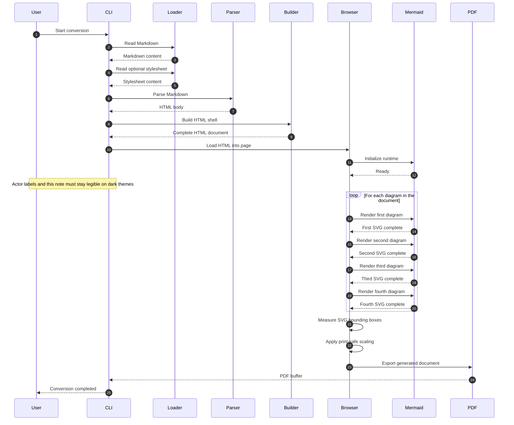

Paragraph after tall diagram: this text should remain clearly below the diagram with no vertical overlap, clipping, or accidental intrusion into the diagram area.

## 3. Small Simple Diagram

This tiny diagram verifies that a small Mermaid block does not get artificially upscaled into an oversized graphic.

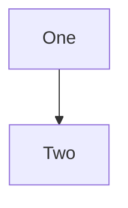

## 4. Diagram with Long Node Text

This chart verifies label handling, wrapping, and clipping behavior for long text inside node shapes.

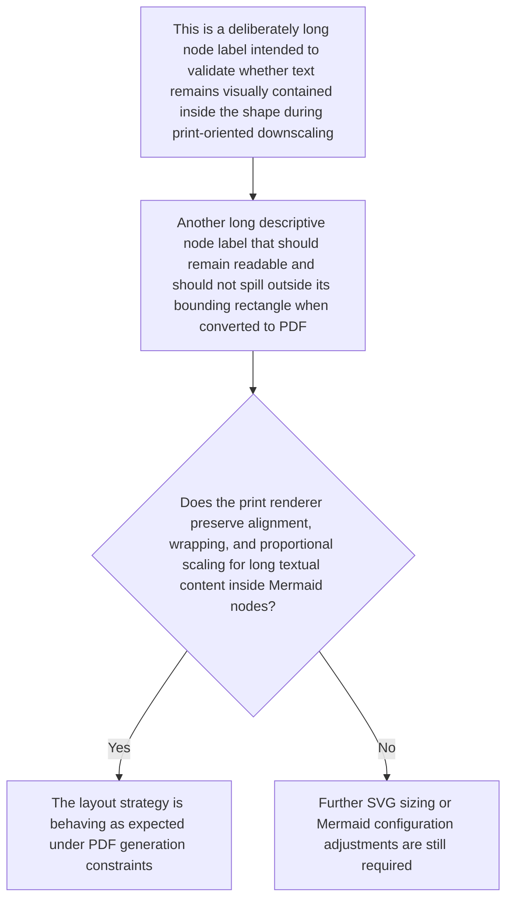

## 5. Mixed Layout Regression Check

Regular content before and after a diagram should remain stable.

### Intro Paragraph

The following chart appears between two ordinary text sections. It should be centered, constrained, and integrated into normal flow without breaking nearby headings or paragraphs.

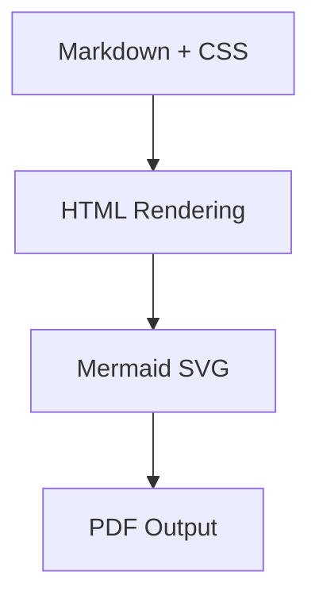

### Closing Paragraph

If this paragraph appears immediately after the diagram without overlap or clipping, the integration with the print layout flow is behaving correctly.

## 6. Gantt Chart

A Gantt chart is painted entirely from Mermaid's own theme variables — task bars, section bands and axis text are not nodes, so the shared block's shape rules never reach them. It is the diagram family that shows whether a theme's selected Mermaid theme actually took effect: under a light theme the bars are Mermaid's pastel default, and under OLED they must be dark surfaces with legible task labels.

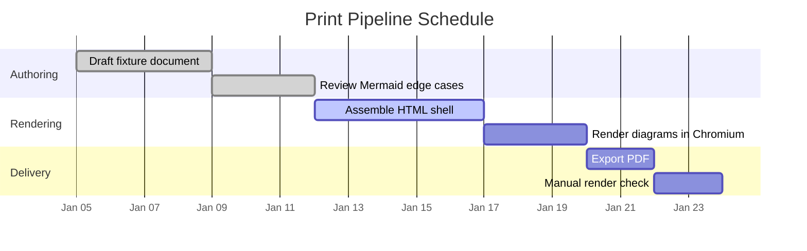

A paragraph after the Gantt chart: the chart must occupy its own vertical band, with the axis labels at the bottom and no bar or gridline crossing into this text.

## 7. State Diagram

A state diagram exercises "default shapes" for the theme selection: rounded state nodes, a filled start marker and a cluster-like grouping, all painted by Mermaid rather than by an author `style` directive.

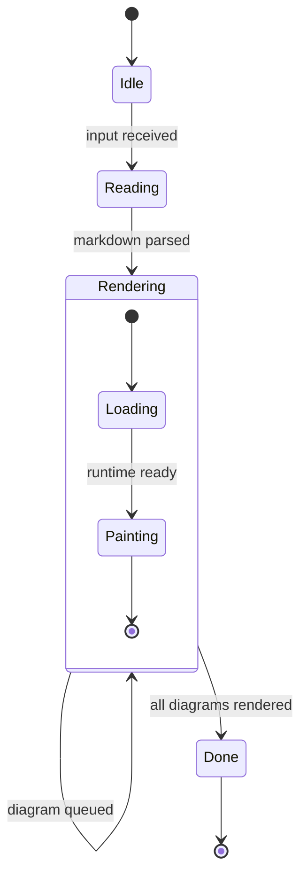

## 8. Pie Chart

A pie chart is the other "default shapes" case, and the one where Mermaid's own slice palette is most visible: a theme that selects a dark Mermaid theme gets dark-appropriate slice colours and legend ink without any selector of its own.

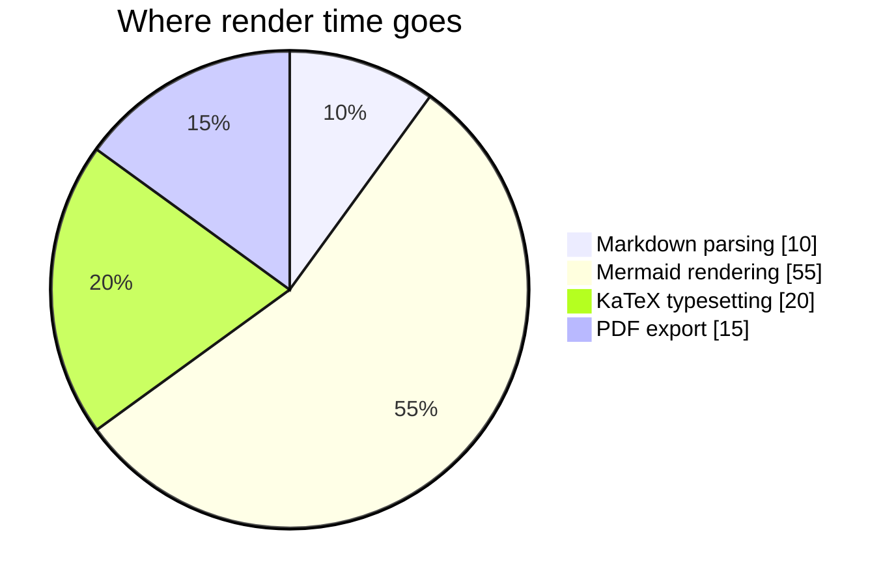

## 9. Gantt Label Surfaces

A Gantt task's name is drawn by Mermaid in one of two places, and the two are different surfaces: a task short enough to hold its name gets the label *inside* its bar, painted on the bar's own fill, while a task whose name would not fit gets it *outside*, drawn on the page. A theme that inks labels by guessing rather than measuring gets one of the two wrong, so this chart declares a short completed task and a long in-progress one whose name overflows to the left of its bar. The in-progress bar is the one Mermaid inks with its own `!important` overflow rule, which is the ink that has to be replaceable.

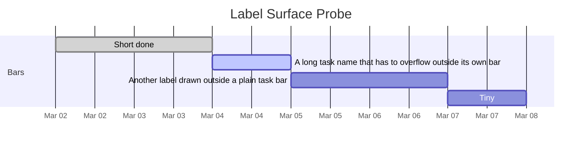

## 10. Class Diagram Label Container

A class diagram draws each class as a `<path>` and writes its name and members into a text container that is a group, not a shape. The group inherits a fill from its ancestors, so a normaliser that samples the nearest element carrying a fill samples the group and reads a dark surface that was never painted — then forces white ink onto a light box. The class names here must keep dark ink on their own light boxes.

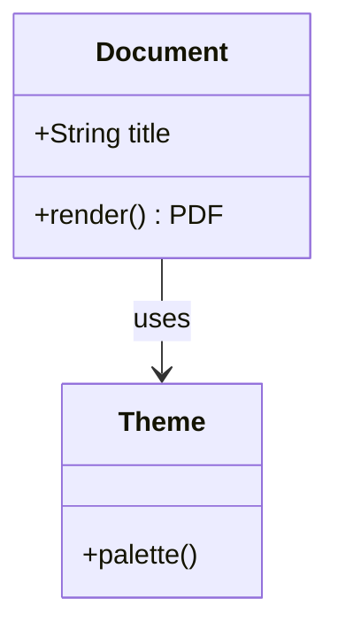

## 11. Composite State Diagram

A composite state nests one cluster inside another, and Mermaid paints that nesting as two rectangles: an `outer` band and an `inner` surface on top of it. The state's name sits on the inner one, so the surface behind a state label is the composite of both — and the ink has to be decided against what is actually visible, not against whichever rectangle came first in document order.

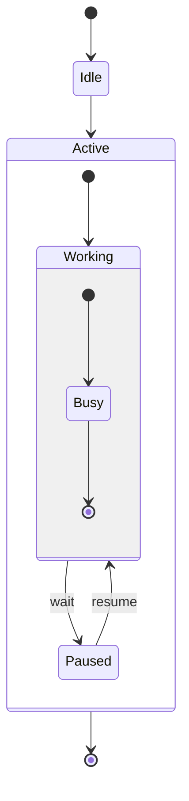

## 12. Author-Supplied Node Fills

These two nodes carry an author `style` directive rather than a theme colour. Mermaid compiles each into an inline fill on the shape, so the surface behind the label is the author's, not the theme's — and the theme's ink is right for one of them and wrong for the other. The dark fill must take light ink and the light fill dark ink, on the same page, in the same diagram.

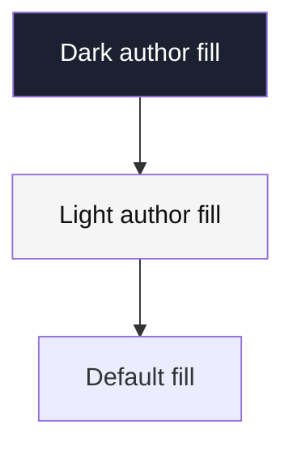

## 13. Multi-Line Edge Labels

An edge label can carry more than one line, and Mermaid draws each line as its own span inside one text element. A label that crosses an edge also sits on the edge-label plate, so its surface is the plate rather than the page. Every line must keep a legible ink, including the lines that are not the first.

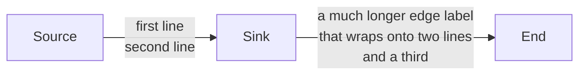

